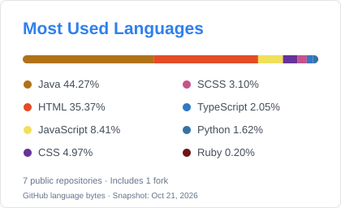

# Hi there! 👋

**Aspiring Web Engineer | Java & Spring Boot**

Learning, building, and growing through every challenge.

 

## About Me

I'm based in South Korea, with a major in Japanese and a minor in Computer Software.
I spent around 11 months living and working in Japan and hold JLPT N1 certification.
My experience in store operations and team management at Starbucks strengthened my communication, collaboration, and problem-solving skills.
I'm now learning web development with Java and Spring Boot, working toward becoming a Web Engineer at an IT company in Japan.

- **Learning:** Building web applications through hands-on team projects.
- **Teamwork:** Led a web development team and coordinated progress and feature specifications.
- **Hobbies:** Working out, listening to music, and meditating.

 

## Stack & Tool

#### Languages & Frontend

#### Backend

#### Database

#### Tools & Environment

 

<picture>
  <source media="(prefers-color-scheme: dark)" srcset="assets/languages-dark.svg">
  <source media="(prefers-color-scheme: light)" srcset="assets/languages-light.svg">
  
</picture>

 

## Featured Projects

### WePlaNet

**Team Project / Web Application**

A web platform for fan communities, fan project funding, and hashtag support campaigns.

**My Role — Team Leader · Backend & Frontend Developer**

- Coordinated project progress and feature specifications.
- Developed the fan project payment functionality.
- Implemented the hashtag campaign feature.
- Implemented the admin log functionality.

**Tech Stack:** Java · Spring Boot · MySQL · JavaScript

[View Repository →](https://github.com/suuzuux/project-DSA)

 

